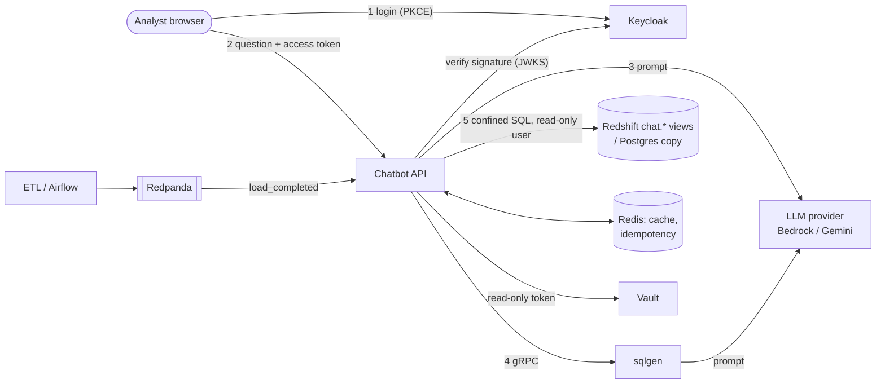

# Threat model (STRIDE): retail sales chatbot

- Date: 2026-10-14 · Milestone 4 · Review again when anything below changes, or by 2027-01-31
  (when the accepted Trivy risks expire)
- Scope: the analytics chatbot and what it touches. The ETL pipeline appears only where it feeds
  the chatbot.

## What we protect

| Asset | Why it matters |
|---|---|
| Each brand's sales and inventory | Brands are competitors. Aurora must never see Cobalt's numbers: the core confidentiality promise. |
| Credentials | Redshift users, LLM API keys (Gemini) and AWS access (Bedrock), Keycloak admin, Vault root token, SMTP |
| The AWS bill | Redshift and Bedrock bill per use, against limited credits. Abuse costs real money. |
| Answer integrity | Numbers people may act on: wrong-but-plausible answers are a harm in themselves |

## System and trust boundaries

Boundaries:
- **TB1, browser ↔ chatbot:** untrusted input crosses here.
- **TB2, chatbot ↔ LLM provider:** data leaves our control. The model's output is untrusted too.
- **TB3, chatbot ↔ database:** the model-written SQL is the most dangerous thing we execute.
- **TB4, cluster internals:** Redis, Redpanda, sqlgen, Vault. Trusted network today, unauthenticated.

## Threats and controls

Status: **mitigated** = a control is in place and tested · **partial** = reduced, gaps stated ·
**accepted** = a known gap, with the reason.

| # | STRIDE | Threat | Control | Status |
|---|---|---|---|---|
| S1 | Spoofing | Anyone calls `/v1/chat` pretending to be a brand user | `AUTH_MODE=oidc`. Every chat request needs a Keycloak access token, with the RS256 signature checked against the realm's JWKS. `iss`, `aud` (= `chatbot-api`) and `exp` are enforced; only RS256 is accepted, so `alg=none` and HS256 swaps fail. Tested: forged, expired, wrong-audience, wrong-issuer and algorithm-swap tokens all get 401. | mitigated |
| S2 | Spoofing | A stolen access token is replayed | 15-minute token lifetime. Stored in the tab's `sessionStorage` (gone when the tab closes), sent only to our origin. No refresh token is stored in the browser. | partial: a token stolen through XSS is usable until it expires (see T3) |
| S3 | Spoofing | Brute-forcing user passwords | Keycloak brute-force protection (lockout after 5 failures); self-registration and password reset off | mitigated |
| S4 | Spoofing | Something inside the network impersonates sqlgen, or reads/writes Redis or Redpanda | Not addressed: these hops have no TLS and no auth | accepted for the local stack. Production needs mTLS (service mesh) or Redis ACLs + TLS and Kafka SASL. |
| T1 | Tampering | The user edits `groups` in their token to gain all-brands | The signature check fails on any edit (demonstrated: a "forged token" gets 401) | mitigated |
| T2 | Tampering | Prompt injection makes the model write SQL that reads other brands or other tables | The model is never trusted with access control. (a) The SQL guard parses with sqlglot: one SELECT, only the routed `chat.*` views. (b) Every brand view is replaced by a subquery filtered to the caller's brands, whatever the SQL says. (c) A SQL literal naming another brand gets 403. (d) The database user is read-only on the `chat` schema. Tested with injection-shaped SQL (`OR 1=1`, CTEs, UNIONs, subqueries). | mitigated; prompt-injection test suite in milestone 5 |
| T3 | Tampering | XSS on the chat page steals the token or rewrites answers | CSP `script-src 'self'` (no inline script), `frame-ancestors 'none'`, `nosniff`. The page renders answers with `textContent`, never `innerHTML`. | mitigated |
| T4 | Tampering | Poisoned cache: one user's answer is served to another | Cache, stale-fallback and idempotency keys include the caller's brand scope (cache) or subject (idempotency). Tested: Cobalt never receives Aurora's cached answer; the same `Idempotency-Key` from another user doesn't replay. | mitigated |
| R1 | Repudiation | "I never asked that" / no record of who saw what | Traces and metrics record steps and timings, deliberately without question text or rows. No per-user audit log yet. | partial: add an append-only audit log (subject, brands, view names, row count, time) without question text |
| I1 | Info disclosure | Brand A sees brand B's data | T2's confinement, plus the model only seeing the caller's brands as known values | mitigated |
| I2 | Info disclosure | Data sent to the LLM provider | Only the question, view metadata and up to 50 result rows. Never credentials or other brands' rows. Bedrock keeps traffic in AWS. Gemini's free tier may use data to improve its models. | partial: use Bedrock for real brand data, Gemini only for the synthetic dataset (AI-governance note) |
| I3 | Info disclosure | Secrets in git or images | gitleaks scans all git history in CI; Trivy scans files and the image for secrets. `.env`, tfstate and `.secrets/` are gitignored; local passwords are generated per Codespace. History checked in milestone 4: only placeholders ever committed. | mitigated |
| I4 | Info disclosure | Secrets in process environment or logs | With Vault, the chatbot's DB password comes from Vault using a read-only token limited to one path, mounted as a file. The env has none (verified). Tokens and secret values are never logged. | mitigated in the auth stack; the laptop still uses `.env` (gitignored, local only) |
| I5 | Info disclosure | `/metrics`, `/v1/health`, `/docs` are open | They expose step names, counts and the model id, no data. Within the cluster only. | accepted: put them behind the ingress's internal-only rules in production |
| D1 | Denial of service | Request floods run up LLM cost or exhaust Redshift's RPU limit | Answer cache; Redshift's daily RPU limit (3) as a hard cap; Bedrock IAM limited to two cheap models; sqlgen deadlines | partial: no per-user rate limit yet. Add one (Redis token bucket per `sub`) before real users. |
| D2 | Denial of service | Expensive SQL ties up the database | LIMIT 500, a 30 s statement timeout on the read-only user, one repair round at most | mitigated |
| D3 | Denial of service | A dependency failure takes the chatbot down | Milestone 3: stale fallback, fast 503s, retries; chaos-tested 6/6 | mitigated |
| E1 | Elevation | A container breakout or a compromised dependency gains root | Image runs as uid 10001. Every pod: `runAsNonRoot`, no privilege escalation, all capabilities dropped, seccomp `RuntimeDefault`, read-only root filesystem (verified: writes fail). Service-account tokens are only mounted where needed (Prometheus). Trivy fails CI on HIGH/CRITICAL fixable CVEs. | mitigated |
| E2 | Elevation | The model's SQL writes or runs DDL | Guard rejects anything but one SELECT; the DB user has SELECT only | mitigated |
| E3 | Elevation | Vault root token misuse | The root token only seeds Vault (dev mode, local); the chatbot gets a 24 h read-only token | accepted for dev mode. Production Vault: no root token in use, Kubernetes auth method, short TTLs. |

## Accepted risks (each has an owner decision and a review date)

| Risk | Why accepted | Revisit |
|---|---|---|
| Redshift security group allows all egress (Trivy AVD-AWS-0104) | Changing it is a live AWS change needing a planned apply and a COPY test | Owner approves a `terraform plan`; expires 2027-01-31 in `.trivyignore` |
| S3 SSE-S3 instead of a customer-managed KMS key (AVD-AWS-0132) | Synthetic data; a CMK costs money against credits | Before any real data; 2027-01-31 |
| No TLS/auth between internal services (S4) | Local Codespace and kind only | Before any shared or cloud deployment |
| Keycloak and the chatbot over plain HTTP | Local only; browser traffic never leaves the Codespace | Same |
| No per-user rate limit (D1), no audit log (R1) | Next milestone's backlog | Before real users |

## How this is checked

- **Unit tests** (`tests/test_security.py`): every token-rejection case, SQL confinement across
  query shapes, 403s, cache and idempotency isolation, CSP headers, the Vault-then-env secret
  order.
- **Live:** `scripts/access_demo.py` against Keycloak, Vault and the chatbot (401 / 401 / 200 /
  403 / confined / 200 / all-brands).
- **CI on every PR:**
  - `secret-scan` (gitleaks, full history)
  - `sast` (bandit, medium+)
  - `trivy` (Dockerfile + Kubernetes misconfiguration, secrets, image CVEs)
  - `k8s-manifests` (schema validation)
